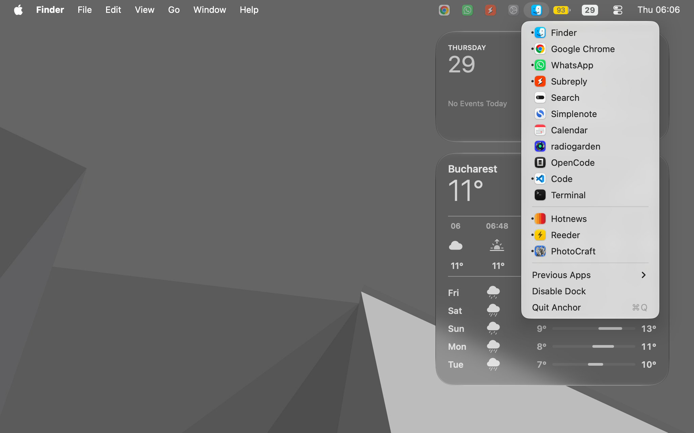

# Anchor



Menu bar dock for macOS.

## Overview

Anchor brings the macOS Dock to the menu bar. It displays the currently active application's icon in the menu bar and provides quick access to all pinned and running Dock applications from a dropdown menu, while relying on the native macOS Dock for app arrangement and management.

## Specifications

### 1. Menu Bar Status Items
- Runs as a menu bar-only application (`LSUIElement` / `.accessory` activation policy, no Dock icon of its own).
- Displays up to 4 previously opened applications' icons on the left as faded (`50%` opacity), clickable status items that switch back to or reopen those applications when clicked.
- Displays the icon of the currently active (frontmost) application (`18x18` pt) with the **total notifications counter** pill on the right (hidden when total count is `0`). Only the current running app icon opens the Dock menu.
- Listens to `NSWorkspace.didActivateApplicationNotification` and polls/observes Dock badge updates to keep the previous app icons, active icon, and total counter in sync.

### 2. Dock Applications List
- Clicking the menu bar icon opens a menu listing all Dock applications:
  - **Finder**: Always listed first, matching macOS Dock behavior.
  - **Pinned Apps**: Read from `~/Library/Preferences/com.apple.dock.plist` (`persistent-apps` array -> `tile-data` -> `file-data` -> `_CFURLString`) in the exact order configured in the system Dock.
  - **Running Unpinned Apps**: Any currently running applications (`NSWorkspace.shared.runningApplications` with `.regular` activation policy) not already pinned in the Dock, shown after a separator.
- Each app menu item displays:
  - The application's icon and localized name.
  - A **notification count badge** using the **same visual style** as the menu bar counter when the app has unread notifications (read via Dock Accessibility `AXStatusLabel`).
  - A running indicator (or state) when the application is currently open.
- Clicking an app in the list activates it (if already running) or launches it (if not running) via `NSWorkspace`.

### 3. System Dock Management ("Disable Dock")
- App pinning, ordering, and removal are managed natively through the macOS System Dock.
- Includes a **"Disable Dock"** toggle option at the end of the app list (after a separator):
  - **When enabled ("Disable Dock" checked)**: Turns on Dock auto-hide (`autohide = true`) and sets `autohide-delay -float 3600` in `com.apple.dock`, then restarts the Dock process (`killall Dock`) so the system Dock remains hidden during normal use.
  - **When disabled ("Disable Dock" unchecked)**: Removes the custom `autohide-delay` (`defaults delete com.apple.dock autohide-delay`) and restarts `Dock` so the user can interact with and manage the native Dock normally.

### 4. Application Controls
- Menu footer (at the end of the list, separated by a divider):
  - **Previous Apps** (submenu with options `Zero`, `One`, `Two`, `Three`, `Four` to configure how many faded previous app icons appear in the menu bar; defaults to `One`)
  - **Disable Dock** (toggleable menu item reflecting current `autohide-delay` state)
  - **Quit Anchor** (`Cmd+Q` to terminate Anchor)

## Technical Stack
- **Platform**: macOS 13.0+
- **Language**: Swift
- **Frameworks**: AppKit (`NSStatusBar`, `NSMenu`, `NSWorkspace`, `LaunchServices` / `ApplicationServices` for reading live notification badges, `UserDefaults` / `Process` for `com.apple.dock`)
- **Permissions**:
  - Unsandboxed to allow reading `~/Library/Preferences/com.apple.dock.plist` and controlling `com.apple.dock` preferences.
  - Reads notification badges directly via LaunchServices (`StatusLabel`) with an Accessibility (`AXStatusLabel`) fallback.

## Building & Running

Build and bundle `Anchor.app`:

```bash
make app
open Anchor.app
```

Or run directly with Swift Package Manager:

```bash
swift run
```


